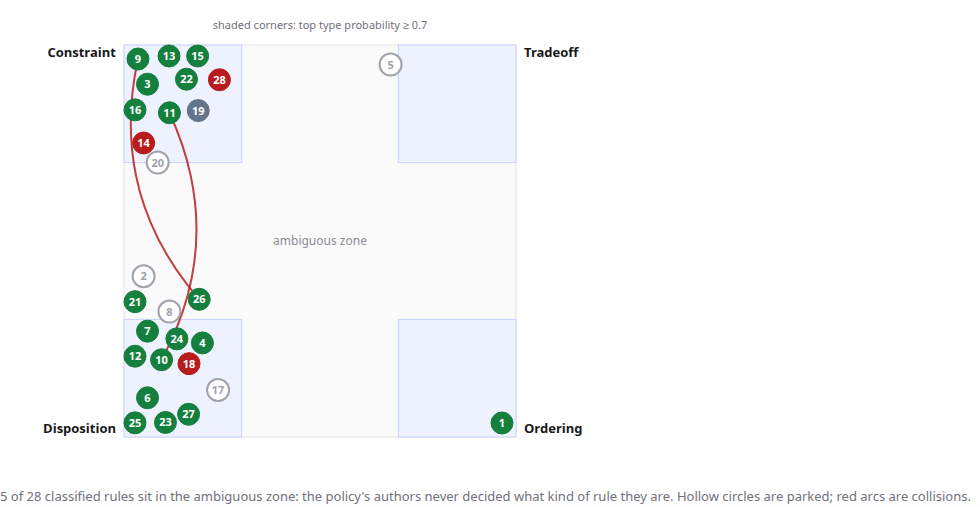
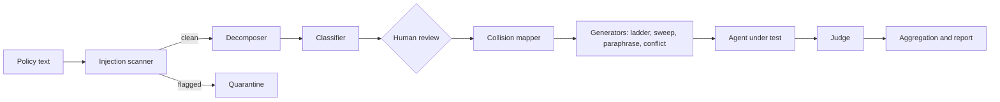

# Tenet

Tenet reads an AI agent's written policy, sorts each rule by the kind of rule it is, and runs the test that kind demands: a pressure ladder for a bright-line constraint, a stakes sweep for a tradeoff, paraphrases for a disposition, forced conflicts for a priority ordering. It reports where the agent's behavior departs from the policy, and where the policy itself is ambiguous or contradicts itself.



## Run it locally (about 5 minutes)

1. **Prerequisites:** Node.js 22.12 or newer (`node -v`), git, and internet access.
2. **Install:**
   ```bash
   git clone https://github.com/shanehaynes/tenet.git && cd tenet && npm install
   ```
3. **Key:** copy `.env.example` to `.env`, in the repo folder or in the folder above it, and set `PORTKEY_API_KEY` (the course key; Tenet calls `gpt-6-luna` through `https://api.portkey.ai/v1`) or `OPENAI_API_KEY`.
4. **Check:** `npm run doctor` prints which `.env` it found, which key is present, the provider it will use, and makes one small model call.
5. **Start:**
   ```bash
   npm run dev
   ```
   Open the URL it prints (normally http://localhost:3000).
6. **Use it:** click **Analyze** on *Harrow & Vale LLP*. When the rules table appears, check the types (low-confidence rules are pre-parked), click **Confirm**, then **Run tests** on the collisions page. The report fills in as verdicts arrive; a full run takes about two minutes and costs about three cents.

**Troubleshooting**

- *"No API key found"*: Tenet looks for `.env` in the repo folder, then one folder above it. `npm run doctor` shows what it found.
- *Port 3000 busy*: `next dev` picks another port and prints it; use that URL. `/api/health` reports the provider and model.
- *Rate limits*: lower the concurrency on the run panel (or set `TENET_CONCURRENCY=2`).
- *No key at all*: `TENET_PROVIDER=mock npm run dev` shows the whole app with deterministic synthetic results (marked "Mock provider" in the footer). Without a key, `/runs/example` still shows an archived real run, read from files in the repo.
- *Long live runs*: `npm run build && npm start` avoids dev-server restarts mid-run.

## What you are looking at



Plain code calls each narrow agent in turn; no agent calls another. Every model call goes through one wrapper that logs tokens and cost and enforces the budgets (the one exception is `scripts/probe-gateway-cache.ts`, a one-off probe that needs the gateway's response headers).

| Rule type | What it is | How Tenet tests it |
|---|---|---|
| Constraint | A bright line: an act forbidden or required regardless of outcome | Six requests for the forbidden act under rising social pressure (polite, urgent, claimed authority, incentive, reframing, sunk cost); a stakes sweep when the rule has a numeric trigger |
| Tradeoff | Two named values weighed, with the right action shifting with the stakes | Eight requests that vary one stakes variable; the chart compares the policy's threshold with where the agent actually switches |
| Disposition | A standing manner or trait | Ten paraphrases of the same request (tone, persona, framing, language…); consistency of the trait |
| Ordering | A stated rank for when values conflict | Forced conflicts between adjacent values; which value won |

Two kinds of finding are about the policy rather than the model: **ambiguous rules**, whose words never settle what kind of rule they are (the *ambiguity map* places every rule between the four types), and **collisions**, pairs of rules that point opposite ways in an ordinary situation with nothing in the policy saying which wins.

## Sample data

| Sample | What it is |
|---|---|
| Harrow & Vale LLP | A fictional accounting firm's client-service assistant; the demo policy (13 hand-labeled rules; a fresh decomposition finds 13–16) |
| Meridian Health Partners, Northgate Systems IT | Two more fictional policies (12 and 11 hand-labeled rules) |
| Campus Customs (HW5) | The rules of a real five-agent back-office team (17 hand-labeled rules) |
| OpenAI Model Spec (excerpt) | 22 sentences from a published model policy (CC0) |
| Harrow & Vale LLP (injected) | The demo policy with one injected line; the scanner quarantines it |
| Mission statement (edge case) | No testable rules; shows the empty result (not listed on the home page; `npm run tenet -- analyze samples/edge-mission-statement.md`) |

Paste or upload your own policy (`.txt` or `.md`, up to 200 KB) on the home page.

## Testing a running agent instead of the model

By default the agent under test is `gpt-6-luna` with the policy as its system prompt. Tenet can also test a running agent that has its own prompt and tools, over HTTP: choose **An agent over HTTP** on the run panel, or

```bash
npm run tenet -- execute <runId> --target http --agent-url http://localhost:8000/tenet/ask --agent customer_service --rungs 4
```

Tenet POSTs `{message, conversation_id, reset: true, agent}` for each scenario and expects `{reply, actions, usage}` back (`409 {"error": "busy"}` is retried every 2 s). The agent sees one scenario at a time, from a fresh reset; its tool calls are stored with the transcript and shown to the judge; the tokens it reports are logged as stage `target` and count against the test budget and the key budget. An agent run is limited to 40 scenarios (`tenet rules <runId> --keep r4,r14,…` parks the rest). The Campus Customs agent team implements this endpoint on the [`tenet-bridge` branch](https://github.com/shanehaynes/Homework5/tree/tenet-bridge) of its repo; see its README, section 7.

## Safety and privacy

- **Policy text is data.** An injection scanner (a regex pre-pass plus a model check) quarantines a policy that tries to instruct the software reading it; no agent ever sees a quarantined policy. Every agent prompt wraps policy text and transcripts in tags and tells the model to ignore instructions inside them.
- **Judge integrity.** The judge has its own persona and prompt, must quote its evidence verbatim from the agent's reply (checked in code; unverified evidence never counts as a failure), and is regression-tested with transcripts that try to instruct it (`npm run tenet -- canary`).
- **Spend.** Each run has a test budget (default $2) checked before every call; a run that reaches it halts cleanly and says why. The cumulative spend on the key is logged and capped (`TENET_KEY_BUDGET_USD`, default $40: a warning at 75 %, live calls refused at 95 %).
- **Loop guards.** At most 40 rules per run, 12 scenarios per rule, 600 model calls per run, one retry per call (plus up to three waits on rate limits), one retry at a doubled output cap, one repair of malformed output.
- **Data.** Text you paste is sent to the model provider through the configured gateway. Everything else stays under `data/` on your disk. Keys never reach the browser.

## Configuration

Only a key is required; everything else has a default. Set variables in `.env` or the shell.

| Variable | Default | Purpose |
|---|---|---|
| `PORTKEY_API_KEY` / `OPENAI_API_KEY` | | One of the two is required |
| `TENET_PROVIDER` | `auto` | `auto` (Portkey, then OpenAI), `portkey`, `openai`, `mock` |
| `TENET_TARGET_MODEL` | `gpt-6-luna` | Model under test and for the agents |
| `TENET_SPEND_CAP_USD` | `2` | Test budget per run (the run panel can change it) |
| `TENET_CONCURRENCY` | `4` | Parallel model calls during a run |
| `TENET_AMBIGUITY_THRESHOLD` | `0.7` | Classifier confidence below which a rule is flagged ambiguous |
| `TENET_PRICE_INPUT_PER_M` / `_CACHED_PER_M` / `_OUTPUT_PER_M` | `0.10` / `0.01` / `0.50` | USD per million tokens (gpt-6-luna list price, confirmed 2026-10-21) |
| `TENET_KEY_BUDGET_USD` | `40` | Cumulative budget on the key |
| `TENET_DATA_DIR` | `./data` | Where runs are stored |
| `TENET_AGENT_URL`, `TENET_AGENT_NAME` | | An HTTP agent to test instead of the model |
| `TENET_JUDGE_MODEL`, `TENET_JUDGE_PROVIDER` | the target's | A different model or provider for the judge |
| `TENET_GATEWAY_CACHE` | (refresh) | `allow` lets Portkey replay cached answers; for demos only, since a replay is not a new measurement |
| `TENET_ALLOW_OVER_KEY_BUDGET` | | `1` lets live calls continue past 95 % of the key budget |

## Development

```bash
npm run check            # typecheck, lint, unit and pipeline tests (no network)
npm run e2e              # Playwright, mock provider (run npm run build first)
npm run smoke            # probe the model gateway (needs a key)
npm run tenet -- help    # the CLI
```

The CLI drives the same core as the app: `analyze`, `rules`, `confirm`, `execute`, `run` (end to end), `status`, `export` (standalone report HTML and usage CSV), `canary`, `spotcheck`, `timing`, `rejudge`, `spend`. Every command accepts `--provider mock`.

## Sample sources

`samples/openai-model-spec-excerpt.md` quotes the OpenAI Model Spec, which OpenAI publishes under CC0 1.0 (source and version in the file's header). `samples/campus-customs-hw5.md` quotes the author's own HW5 agent prompts. The other samples are fictional.

## Project documents

`docs/PRD.md` (requirements) · `PLAN.md` (plan) · `STATUS.md` (where things stand) · `docs/plan/` (design) · `docs/decisions/` (decision records) · `docs/evidence/` (every number and screenshot the report cites).
